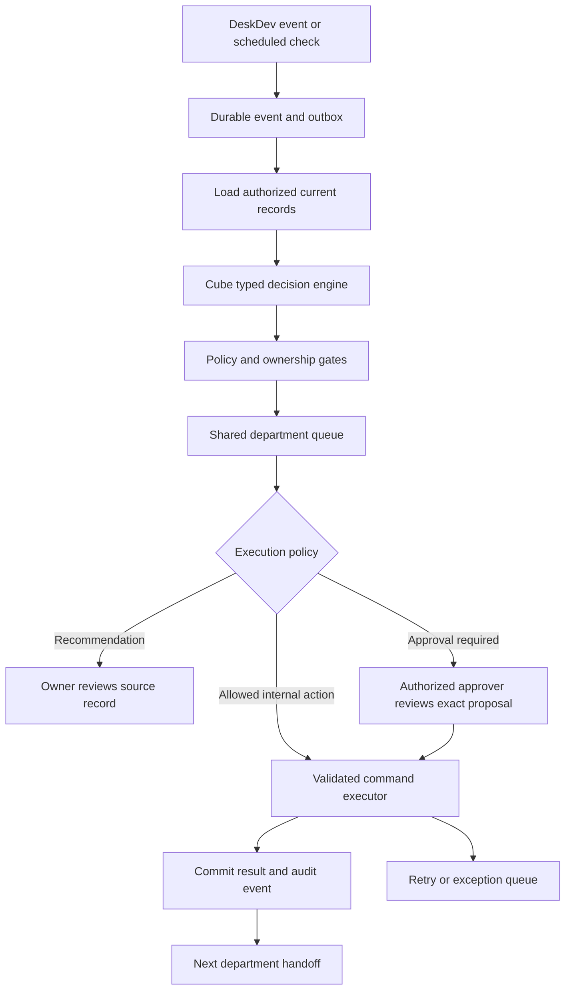

# Cube: DeskDev operational decision and orchestration plan

Planning date: 2026-10-08. Status: proposal; this document does not authorize deployment, migrations against live data, or remote actions.

Owner direction received after this plan: all departments and admin responsibilities,
automatic internal operation, workflow analysis by the agent, and contract-file
integration later. The first implemented increment is documented in
[Cube automatic operations](CUBE-AUTOMATIC-OPERATIONS.md). The implementation
does not imply completion of every later phase below.

## Product direction

Cube should become DeskDev's operational coordination layer: detect what needs attention, select a permitted next step, route it to an accountable department owner, and track the result across handoffs.

The System One inspiration is a small, fast decision interface whose outputs are constrained to known choices. TypeSafe describes Jev as returning typed probabilistic decisions from supplied state, with the surrounding software defining the workflow: [TypeSafe's introduction](https://typesafe.ai/blog/introducing-system-one-models-and-jev). Cube can adopt this interface and composition pattern without claiming to reproduce Jev's training or architecture. Correct output types alone do not establish that a business decision is correct.

Cube's first operational release should be a deterministic engine with versioned playbooks and a hardcoded orchestrator. It should have no learned probabilities. A future trained Cube model can implement the same interface after labeled examples, evaluation, and deployment economics support that investment. An optional model provider could help classify ambiguous inputs before then, but is not required for the initial system.

## Existing foundation verified in the workspace

- `site/src/deskdev/cube/engine.ts`: pure evaluator; typed actions, reason codes, evidence, fingerprints, permissions, workspace timezone, unavailable-source handling.
- `site/src/deskdev/pages/Cube.tsx`: inbox, department filters, playbook controls and review history.
- `site/src/deskdev/cube/journal.ts`: account-scoped personal acknowledgement, snooze and reopening. This is browser storage, not shared operational approval.
- Current playbooks: Growth lead follow-up, Delivery blocked work, Finance engagement readiness.
- Current roles are admin/member with feature permissions. Department membership and department approval authority are not modeled.
- Engagement records have versioned, awaited saves and server validation. They record external agreement and payment evidence; DeskDev does not process payments or sign contracts.
- Existing reminders, notifications and n8n workflows already cover some operational messages. Cube must coordinate with their owners rather than duplicate them.

The prototype evaluates while its page is open. It cannot currently run company operations in the background, execute business mutations, or coordinate shared approvals. Preserve the existing implementation and extend it in stages. No statement here certifies that it is deployed or that current repository tests pass.

## Department playbooks

The following departments are proposed operating responsibilities, not a claim about the company's current org chart. Confirm names, owners, service hours and handoff deadlines with the owner during phase 0.

| Department | Initial decisions | Suggested action | Structured prerequisites |
|---|---|---|---|
| Growth / Sales | Lead missing owner; first response overdue; follow-up due; ready for handoff | Route to Growth owner; prepare follow-up task; submit qualified lead handoff | Existing lead records; add qualification requirements and department routing |
| Client Operations | Missing intake documents; onboarding incomplete; client decision overdue | Request internal follow-up; prepare onboarding checklist; escalate unanswered approval | Onboarding checklist, required assets, request dates, account owner |
| Delivery / Engineering | Blocked work; missed deadline; dependency unresolved; kickoff ready | Escalate blocker; prepare task bundle; offer kickoff after prerequisites | Existing tasks/projects; add dependency and blocker reason records |
| Creative / Content | Brief incomplete; asset ready for review; revision outstanding | Route review; return brief with explicit missing fields | Versioned briefs, asset records, review outcomes, revision counts |
| Finance | Acceptance/deposit incomplete; invoice due; milestone evidence missing | Hold kickoff; route reconciliation; prepare collection reminder for approval | Existing engagements; approved financial policy and receipt evidence |
| People / Capacity | No eligible assignee; workload above agreed limit; skill gap | Suggest eligible owner; propose reassignment; escalate capacity conflict | Skills, availability, working hours, planned effort, leave and capacity limits |
| Leadership / Operations | Handoff overdue; repeated blocker; unresolved critical exception | Daily exception digest; route to department head; pause affected playbook | Shared decision history, handoff ownership, deadlines and escalation policy |

Launch with Growth, Delivery and Finance because their source records already exist. Introduce the other playbooks only after their prerequisite data and access policy exist. A department label must never grant access by itself.

## Orchestration design



Hardcode playbook graphs, rule precedence, allowed commands, transition guards and escalation paths in reviewed TypeScript. Put business hours, response targets, department owners and approved thresholds in validated configuration with version history. Do not hardcode people or prices into the engine.

Every playbook declares its trigger, required sources, applicability, ordered rules, permitted outputs, owner resolver, approval authority, cooldown, retry policy, completion evidence and version. Missing, stale or failed source data produces `insufficient_data`; it cannot imply that a prerequisite is satisfied.

State progression: `proposed -> awaiting_approval -> approved -> executing -> succeeded`. A recommendation can resolve after an observed source change without execution. Separate outcomes include rejected, stale, cancelled, insufficient_data and failed. Snooze is a review scheduling property; acknowledgement is not approval or completion. Retrying execution has a bounded attempt count and preserves attempt history.

Resolve conflicts deterministically: permission and financial gates first; blocked prerequisites next; escalation and deadline handling next; optimization suggestions last. One command owns each affected transition. Notify the relevant owner once per decision revision and escalation level.

### Decision contract

```ts
type CubeEvaluation = {
  decisionId: string
  playbookId: string
  playbookVersion: number
  policyVersion: number
  departmentId: string
  subject: { type: 'lead' | 'task' | 'engagement'; id: string }
  sourceVersions: Record<string, string>
  outcome: 'recommend' | 'request_approval' | 'eligible_internal_action' | 'insufficient_data'
  reasonCodes: string[]
  evidenceRefs: string[]
  ownerId: string | null
  command: CubeAllowedCommand | null
  idempotencyKey: string
  evaluatedAt: string
  expiresAt: string
}
```

`CubeAllowedCommand` must be a discriminated union of explicit operations, such as create an internal follow-up task or submit a department handoff. Avoid arbitrary tool names, code execution, SQL or unconstrained payloads. Validate runtime inputs as well as TypeScript types. Reuse existing domain validation and define commands separately from recommendation links.

For rules, show matched conditions and evidence completeness. Do not manufacture a confidence percentage. If a learned decision provider is introduced, record its model version and task-specific probabilities separately from rule eligibility and authorization.

## Example: lead to delivered project

1. An open lead arrives. Cube flags a missing owner or expired reply deadline for Growth.
2. Growth records qualification and requests a handoff. The proposed handoff specifies owner, scope, due date, prerequisite evidence and source revision.
3. Finance records external acceptance and confirmed deposit evidence. Cube uses the existing engagement gate; it cannot invent a receipt or override that gate.
4. Client Operations confirms required assets and onboarding. The next release needs structured intake records for this check.
5. Delivery accepts the handoff. An approved command creates the agreed task bundle once, after checking that the engagement and intake are still current.
6. Creative and Engineering receive only their authorized tasks and approved brief. Blocked dependencies return to the named upstream owner.
7. A reviewer records QA results and milestone approval evidence. Cube routes outstanding issues and suggests completion only when the domain prerequisites pass.
8. Finance reviews the remaining receivable. Leadership sees unresolved exceptions and elapsed handoff time.

No handoff is complete merely because the receiving department was notified. It needs an acceptance or rejection with a reason, and a timeout routes it to a named escalation owner.

## Data and execution boundaries

Proposed tables, subject to schema review and the next free migration number:

| Record | Purpose |
|---|---|
| `departments`, `department_memberships` | Owners, scope and approval authority |
| `cube_playbook_settings` | Versioned enablement, service hours, thresholds and execution mode |
| `cube_events` | Durable input events with producer deduplication key |
| `cube_decisions` | Current decision, evidence references, subject revision and lifecycle |
| `cube_reviews` | Shared human review, rejection and approval of a specific revision |
| `cube_handoffs` | Sending/receiving department, prerequisites, due time and acceptance |
| `cube_action_runs` | Command attempts, leases, idempotency key and confirmed result |
| `cube_outbox` | Transactionally committed internal events and delivery requests |

Keep evidence access-controlled; do not copy financial values into general department summaries. Build a permission-filtered operations view rather than exposing privileged runner output directly to the browser. Server-side checks must enforce feature access, record scope, active-account status and department approval authority. Financial access remains active-admin-only unless a separately approved policy changes it.

Use Supabase server functions/Edge Functions for transactional commands and authorization. Keep the pure decision package outside the mirrored mobile `lib` until mobile integration is deliberately added. The UI consumes durable decisions; its local optimistic store must not declare a server command successful before confirmation.

Commit source mutation and outbox event in the same transaction when possible. A scheduled reconciler catches missed events and time-based deadlines. Workers claim leases, retry with backoff and send exhausted runs to an exception queue. Recheck source versions, permissions, policy and approval at execution time; changed facts invalidate old approval. Pin the approved playbook version rather than silently changing the execution logic.

Reuse the existing n8n system as an integration executor where suitable. Cube owns business decisions and the command lifecycle; n8n reports confirmed execution outcomes. Deduplicate against existing task reminders and lead nudges before enabling a second sender. External calls need provider-supported idempotency where available; ambiguous delivery results require reconciliation instead of an unchecked repeat. Promise effectively-once business effects, not universal exactly-once delivery.

## Execution policy

| Mode | Enabled behavior |
|---|---|
| Observe | Evaluate and compare with human outcomes; no business writes |
| Recommend | Shared inbox and proposed actions; humans operate source records |
| Approve | An authorized reviewer approves an exact command and current evidence |
| Internal automation | Explicitly allowlisted, reversible internal actions under approved policy |

Initial automated candidates: internal follow-up task creation, handoff records and deduplicated internal reminders. Owner reassignment needs workload and authority rules before automation. External messages, publishing, changed prices, contract commitments, financial postings, deletion, access grants and deployments remain approval-gated. Initial planning does not authorize any of those actions.

Provide workspace and per-playbook pause controls. A pause blocks new executions, including already approved commands that have not started; currently executing operations need an explicit cancellation/compensation policy. Show source failures, stalled runs and unavailable departments in the UI.

## Delivery phases and acceptance gates

1. **Phase 0: define the operation.** Confirm department owners, allowed actions, service hours, handoff prerequisites and source-of-truth fields. Inventory existing automation to assign one sender per workflow. Gate: approved policy matrix and representative cases for the three existing playbooks.
2. **Phase 1: shared recommendations.** Add RLS-protected decisions/reviews and ownership without business mutation. Preserve personal snooze semantics separately. Gate: users cannot access another department's restricted records; history works across devices; evidence changes invalidate review; unavailable data is visible.
3. **Phase 2: durable orchestration.** Add transactional events/outbox, scheduled evaluation, handoffs, leases and exception handling. Start in observe/recommend mode. Gate: replayed or duplicated events do not duplicate decisions; paused playbooks do not execute; missed events reconcile; stale approvals are refused.
4. **Phase 3: approved internal execution.** Add awaited, idempotent command handlers for task creation and handoffs. Gate: duplicate approval/click/retry creates one business effect; permissions are rechecked; conflicts preserve user work; failures surface in the inbox.
5. **Phase 4: more departments and selective automation.** Add onboarding, briefs/reviews, dependencies and capacity data. Enable one proven low-risk internal action at a time. Gate: owner-reviewed replay dataset, complete prerequisites, bounded retries, useful exception volume and proven pause controls.
6. **Phase 5: learned Cube decisions.** Label accepted, corrected, rejected and unresolved examples, with adjudicated outcomes. Compare rules with a classifier or model provider in shadow mode. Train a small department-specific model only if it materially improves accuracy, latency, privacy or cost. Gate: time-separated held-out evaluation, calibrated probabilities when offered, safe abstention, drift monitoring and a rules-only fallback.

Estimate phases after phase 0 establishes scope and resolves current release blockers; avoid an unsupported calendar promise.

## Validation and operational measures

Test deterministic output, precedence, business timezone boundaries, missing data, archived records, inactive owners, permission changes, duplicate events, lost responses, worker restarts, concurrent approval, changed source revisions and upstream outages. Database tests use throwaway PGlite/Supabase, never live data. Browser video proof covers each enabled department path and its failure path.

Track recommendation usefulness, correction/rejection reasons, time to owner acceptance, handoff age, unresolved exceptions, duplicated effects, execution success, data freshness and notification volume. Establish targets from reviewed baseline data; model confidence and acknowledgement count are not operational success metrics.

Apply repository checks and the release gate for implemented phases. New migrations must be idempotent, ledgered, RLS-protected and tested locally; references to profiles use `ON DELETE SET NULL`. Privileged functions require explicit grants and a fixed search path. No service-role key goes to the site Worker or browser. Remote migration and production deployment remain owner-authorized.

## Recommended first increment

Keep the current Cube interface and three playbooks. Build shared recommendations and department ownership first, then a durable Growth -> Finance -> Delivery handoff with approved internal task creation. This provides a complete operational loop before expanding into departments whose source data is still missing.
